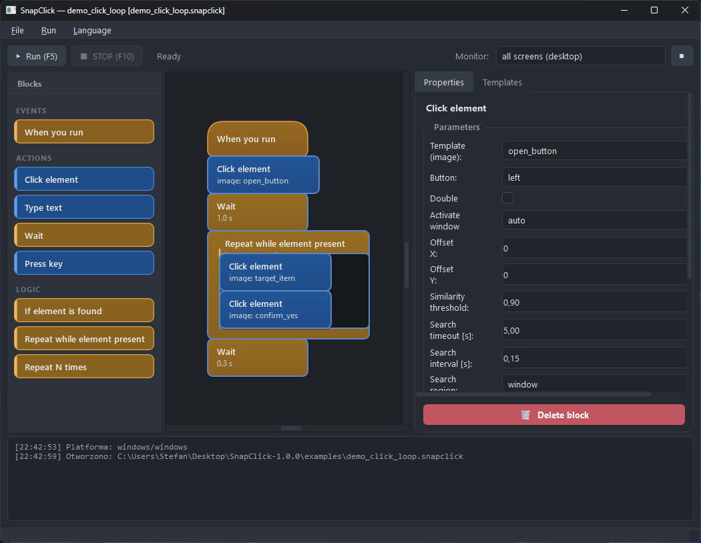

# SnapClick

**Point. Click. Automate.** — a visual, block-based automation tool driven by
computer vision.

SnapClick lets you teach a computer to click things **by showing it pictures
of them**. No code, no scripting syntax, no selectors. You drag blocks onto a
canvas — *find this button*, *click it*, *wait*, *if this shows up, do that* —
press Run, and SnapClick drives your mouse and keyboard for you, looking at
the same screen you do.

It works on **anything on your screen**: games, desktop apps, browsers,
internal tools, that one website with no API. If you can see it, SnapClick can
click it.



## What it looks like in practice

- 🖱️ **"Click the Buy button whenever it appears"** → drag `Start`,
  `Click element`, `While element visible` — done.
- ⌨️ **Fill a form on a page that ignores automation** → `Type text` sends
  real keystrokes (full Unicode, accents included).
- 🔁 **Repeat a chore 200 times** → `Repeat N times` with per-step delays.
- 🧠 **React to what's on screen** → `If / Else` branches on *is this image
  visible right now?*
- 🎯 **Work on multi-monitor setups** → every block can search the whole
  desktop, one monitor, one window, or a hand-drawn region.

## Features

- **Block-based editor** — Scratch-style blocks with snap sockets: click,
  type, press keys, wait, save variables, if/else, while, repeat, break,
  continue. Live validation tells you what's broken *before* you run.
- **Template capture built in** — freeze the screen, drag a box around any
  element, name it. That's your "selector". PNG alpha channels work as
  masks.
- **Vision matching** — OpenCV `matchTemplate` with thresholds, timeouts and
  search regions. A *Vision test* button shows you exactly where (and
  whether) a template is found on screen right now.
- **Robust input** — real button-hold timings, cursor settle delays, window
  focus handling, and a `PostMessage` fallback for stubborn apps that ignore
  synthetic input.
- **Variables** — store values mid-run and type them later.
- **Instant STOP** — global hotkey, kill-switch listener, per-block timeouts
  and loop limits so a runaway scenario can't spin forever.
- **Bilingual UI** — English and Polish, switchable live without restart.
- **Cross-platform** — Windows 10/11 and Linux (X11). Same scenario file on
  both.
- **Portable** — the standalone build keeps *everything* (settings, projects,
  logs) in a `snapclick-data/` folder next to the binary. Copy the folder to
  a USB stick, it still works.

## Download & run

Grab the latest release from the [Releases page](../../releases):

| Platform | File | How |
|---|---|---|
| Windows 10/11 | `SnapClick-x.y.z-windows.zip` | unzip, run `SnapClick.exe` |
| Linux (X11) | `SnapClick-x.y.z-x86_64.AppImage` | `chmod +x` it, then double-click or run it |
| Linux (no FUSE) | `SnapClick-x.y.z-linux.tar.gz` | `tar xzf` it, then `./SnapClick-x.y.z/SnapClick` |

Both Linux builds are portable: settings, projects and logs live in a
`snapclick-data/` folder next to the file you run.

> **Heads up (Windows):** builds are unsigned, so SmartScreen may warn on
> first launch — *More info → Run anyway*.
> **Heads up (Linux):** you need an **X11/Xorg session**; Wayland is not
> supported (the app tells you clearly if it finds one). If the AppImage
> complains about FUSE, use the `.tar.gz` instead.

## Your first scenario

1. **File → New project** — pick a folder; template images are stored in an
   `assets/` folder next to the `.snapclick` file.
2. **Capture a template** — in the *Templates* panel hit **Capture**, frame
   some small, distinctive UI element (a button works great). Keep crops
   small and high-contrast; whole windows ruin matching.
3. **Build the flow** — drag `Start`, then `Click element`, pick your
   template, choose a search region.
4. **Sanity-check** — *Vision test* highlights the match on your live screen;
   *Validate* flags missing Start blocks, dangling wires, loops without
   bodies.
5. **Run** — press **Run** (F5). **STOP** (F10) halts immediately. The block
   being executed is highlighted and the log shows scores and coordinates.

There's a ready-made example in [`examples/`](examples) —
`demo_click_loop.snapclick` (its template images are synthetic, so open it,
read the flow, then replace the templates with your own captures).

## Blocks at a glance

| Category | Block | Does |
|---|---|---|
| Flow | `Start` | entry point (exactly one) |
| Actions | `Click element` | find a template, click LMB/RMB (or just move the cursor) |
| Actions | `Type text` | type a constant or variable — full Unicode |
| Actions | `Press keys` | single key or shortcut (`ctrl+f`) |
| Actions | `Wait` | pause in seconds |
| Actions | `Save variable` | stash a value for later blocks |
| Logic | `If / Else` | branch on *template visible* or *previous step result* |
| Logic | `While visible` | loop while a template is on screen (hard iteration cap) |
| Logic | `Repeat N times` | counted loop |
| Flow | `Break` / `Continue` / `End scenario` | loop & flow control |

Every action block has a **when element missing** policy (stop / continue /
jump to block), a **search timeout**, and a **post-action delay**.

## Running from source

```bash
python -m venv .venv
.venv/Scripts/pip install -r requirements.txt   # Linux: .venv/bin/pip
.venv/Scripts/python main.py                    # Linux: .venv/bin/python main.py
```

Python 3.11+. On Linux you need an X11 session and `python3-xlib`
(installed via requirements on Linux).

```bash
python -m pytest tests -q    # 117 tests, no display or real apps required
```

## Building your own bundle

```bash
pip install -r requirements-build.txt
scripts/build_windows.bat      # Windows -> dist\SnapClick.exe
bash scripts/build_linux.sh    # Linux   -> dist/SnapClick
python scripts/make_icon.py    # packaging/snapclick.png (AppImage icon)
bash scripts/build_appimage.sh # Linux   -> dist/SnapClick-<ver>-x86_64.AppImage
python scripts/package_artifact.py   # zip / tar.gz in dist/
```

Releasing a new version is one command:

```bash
python scripts/release.py 1.1.0
```

It bumps the version, runs tests, commits, tags `v1.1.0`, pushes, and GitHub
Actions builds and attaches both platform bundles to the release.

## Project layout

```
snapclick/
  core/
    platform/    screen / input / window backends (win32, x11, autodetect)
    vision/      template matching + PNG template catalog
    model/       block definitions, program graph, validation, serialization
    engine/      interpreter (runs in a worker thread), context, events
    paths.py     portable data dir next to the app
  i18n/          EN/PL catalogs, live language switch
  gui/           main window, block canvas, palette, properties, capture,
                 templates panel, runner
  project/       .snapclick file format + autosave + assets/
examples/        demo scenario (synthetic templates)
scripts/         example generator, build & release helpers
tests/           platform, vision, model, engine, GUI and i18n tests
```

## Tips & troubleshooting

- **Element not found?** Lower the similarity threshold (0.90 → 0.80), make
  the crop smaller and more distinctive, narrow the search region, and make
  sure the screen scale matches when you captured the template.
- **Clicks not landing?** Increase *button hold* and *cursor settle* in
  *Run → Input Settings*. If the app runs as administrator, run SnapClick as
  administrator too. For apps that filter injected input, switch the click
  (and text) delivery to **PostMessage** in the same dialog.
- **Linux: "backend unavailable"?** `echo $XDG_SESSION_TYPE` must say `x11`.
  Log into an "Xorg" session.

## Disclaimer

SnapClick automates *your* own screen, on *your* accounts and machines.
Automating online games or services may violate their terms of service and
get you banned — check the rules and use it responsibly. You are
responsible for what your scenarios do.

## License

[MIT](LICENSE)
